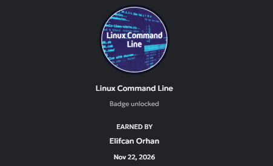

# 05 – Linux Command Line (Immersive Labs)

**Source:** Immersive Labs, *Linux Command Line* series (Cyber Fundamentals)
**Completed:** November 2026, digital badge earned
**Tools:** Linux terminal (bash), nano, find, grep, sort, tr, sed, chmod, sudo, su, ssh, scp, md5sum

> Lab answers and tokens are intentionally not included. This write-up summarises the skills I practised and why they matter in a SOC.



## 1. Why Linux matters for a SOC analyst

Many servers, security tools and log sources run on Linux. A SOC analyst often needs to work in a
terminal: moving around the file system, searching files and logs, checking who can access what,
and confirming that a file has not been changed.

## 2. What I practised

| Area | Commands | What I can do |
|------|----------|---------------|
| Navigation | `pwd`, `ls -la`, `cd`, `cd ..` | Move through the file system with full and relative paths, and show hidden files |
| File management | `mkdir`, `touch`, `mv`, `rm`, `rm -r` | Create, rename, move and delete files and folders |
| Editing | `nano` | Open, edit and save files in the terminal |
| Searching | `find`, `grep` | Find files by name, part of a name, owner or permissions, and search for text inside files |
| Text processing | `sort`, `tr`, `sed` | Sort output, delete or replace characters, and find and replace words |
| Redirection and chaining | `>`, `>>`, `<`, `2>`, `\|`, `&&`, `&` | Save output and errors to files, pass output from one command to another, and run commands in sequence or in the background |
| Permissions | `ls -l`, `chmod` | Read permissions as letters (`rwxr-xr-x`) and numbers (`755`), and change them |
| Users and privileges | `sudo -l`, `sudo -u`, `su -l` | Check what I can run with sudo, run a command as another user, and switch accounts |
| Remote access | `ssh`, `scp`, `ssh -i` | Log in to a remote server, copy files from it, and use a private key instead of a password |
| File integrity | `md5sum`, `sha1sum`, `sha256sum` | Create hashes to check whether a file has been changed |

## 3. Example commands

General examples of the techniques used in the labs:

```bash
# Find a file anywhere on the system and hide "Permission denied" errors
find / -name 'backup*' 2>/dev/null

# Find files under /usr owned by a user that everyone can read, write and execute (777)
find /usr -user bob -perm 777

# Search a log for failed logins, sort the results and save them to a file
grep 'Failed' auth.log | sort -r > failed_logins.txt

# Remove punctuation from a file, then replace a word in a file
tr -d '[:punct:]' < input.txt > clean.txt
sed 's/old/new/g' input.txt > fixed.txt

# Check sudo rights, then run an allowed command as another user
sudo -l
sudo -u alice cat /home/alice/notes.txt

# Copy a file from a server, protect the private key and log in with it
scp alice@10.0.0.5:/home/alice/file.txt /home/linux/file.txt
chmod 600 ssh_key
ssh -i ssh_key bob@10.0.0.5

# Create a hash of a file to check its integrity
md5sum report.txt
```

## 4. Security relevance

- **Permissions:** files with `777` permissions can be changed by anyone. Searching for them with
  `find -perm` helps to spot weak configurations.
- **Privileges:** `sudo -l` shows which commands a user can run as someone else. Attackers check this
  when they try to escalate privileges, so analysts need to understand it too. Sudo rights are
  controlled in `/etc/sudoers`, and failed sudo attempts are logged.
- **Logs:** Linux logs are kept in `/var/log`. `grep`, `sort` and pipes make it quick to search them
  during an investigation.
- **Hashes:** changing a single character gives a completely different hash. Analysts use hashes to
  check file integrity and to identify known malware (indicators of compromise).
- **SSH keys:** a private key works like a password, so it must be protected (`chmod 600`).

## 5. What I learned

<!-- Feel free to rewrite this section in your own words. -->

- The terminal is very exact. One extra space can break a path, and hidden files need the dot at the
  start of their name.
- A path that starts with `/` (for example `/root/file.txt`) starts from the top of the file system.
  Without the `/`, the terminal looks inside the folder I am currently in.
- `|` passes the output of one command to the next command. `&&` only runs the next command if the
  first one was successful.
- `sudo` uses another user's rights for a single command, while `su` switches to that user completely.
- In the hashing lab I accidentally left one extra space in a file, and the MD5 hash was completely
  different. This showed me clearly why hashes are used to check file integrity.
